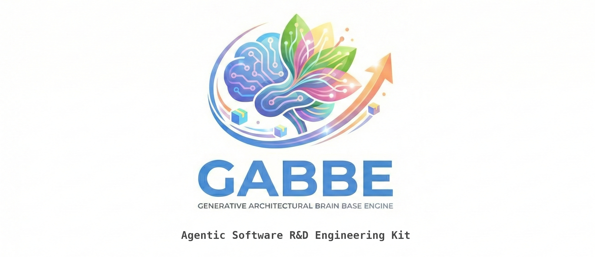
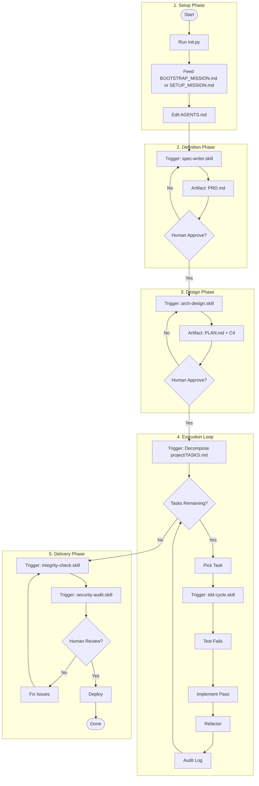
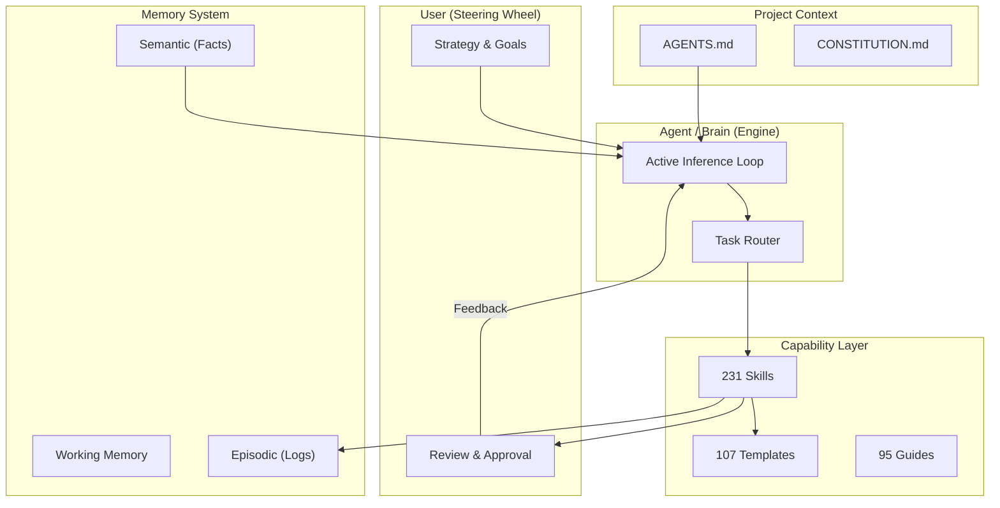
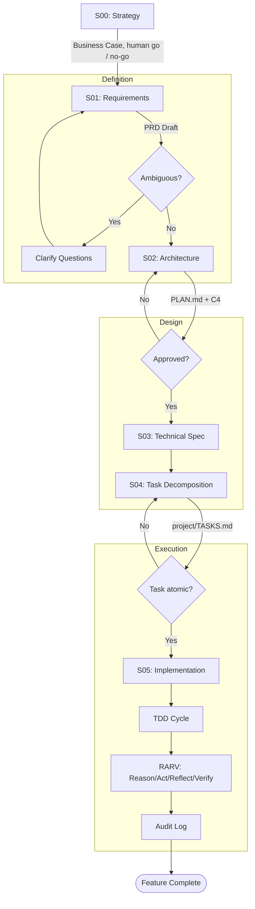
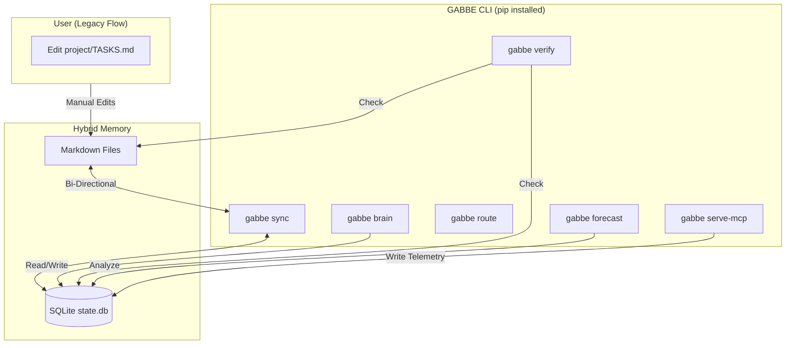

# GABBE (Generative Architectural Brain Base Engine)
## Agentic Software R&D Engineering Kit

<!-- mcp-name: io.github.andreibesleaga/gabbe -->

## Quick Reference



## What is this?

**GABBE turns the AI coding agent you already use into a governed software engineering team.**
It plans, writes specs, designs, tests and ships through quality gates, follows proven engineering
methods, and stops for your approval where it matters. Open source, for any language, any project
(new or existing) and any team size.

**Why use it**

- **One kit for every agent.** Claude Code, Cursor, Windsurf, GitHub Copilot / VS Code, Gemini,
  OpenAI Codex, Cline, Aider, Devin, Antigravity, OpenCode, Zed, Continue, Roo Code and Kilo Code.
  Skills are written once and installed in each tool's own format (Cursor `.mdc`, Copilot
  `SKILL.md`, `.claude/skills`, and `.agents/skills/` for agentskills.io tools). Switch agents
  mid-project: the project state exports and imports.
- **Engineering discipline built in.** One lifecycle from idea to retirement (S00–S13): strategy
  and discovery (Day 0), build and ship (Day 1, S01–S10), then operate, evolve and decommission
  (Day 2). Every phase ends at a gate; six of them are human approvals. Work is spec-driven (spec → evals → tests → code) and grounded in named methods: ADD 3.0,
  ATAM, Wardley mapping, JTBD, RICE, DORA/SPACE, ADKAR.
- **You stay in charge.** Human approval for risky or expensive steps; budgets, token limits and
  hard stops; policy rules; an audit trail and deterministic replay. You manage the agents instead
  of operating them.
- **Safer AI output.** Evals (LLM-as-judge, RAG and trajectory evals) and guardrails (prompt-injection
  defence, output validation) mapped to the OWASP LLM Top 10, NIST AI RMF, MITRE ATLAS, ISO 42001
  and the EU AI Act.
- **Tests that look for real failures.** Property-based, metamorphic, chaos / fault-injection and
  mutation testing (`gabbe verify --chaos`).
- **See what the agents did and what it cost.** Decision and cost traces in the OpenTelemetry GenAI
  conventions.
- **Scales from a bug fix to a large programme.** **Loki Mode** runs a swarm of 37 specialist roles
  with episodic and semantic memory, checkpoints and a project history. **Brain Mode** (experimental)
  is a meta-cognitive orchestrator, inspired by neuroscience and cognitive psychology (Active
  Inference), that plans, routes work between local and remote models and learns from past outcomes.
  Agents pick the right skills and guides for each task and recommend the MCP servers it needs.
- **Installs in one command.** `npx gabbe-kit init` (no Python needed) or
  `curl -fsSL …/install.sh | sh`; `pipx install gabbe` adds the CLI. `gabbe doctor` detects your OS,
  runtimes and agents; updates and uninstalls are tracked in a manifest.

**Honest limits.** Budgets, policy rules, the tool gateway (MCP server) and replay are experimental.
The self-evolving "genes" model is a conceptual framing: the shipped brain chooses prompts by
epsilon-greedy selection on their success rate. Evals and property-based tests sample behaviour and
raise confidence; they do not prove correctness.

It contains:
- **231 Skills** (specialized capabilities)
- **107 Templates** (standardized documents)
- **95 Guides** (language & domain expertise)
- **37 Personas** (specialized roles)
- **66 MCP servers** (configuration and guides for AI tools)
- **Brain Mode** (meta-cognitive orchestration)
- **Loki Mode** (multi-agent swarm engineering personas team for large projects)

> **231 Skills · 107 Templates · 95 Guides · 37 Personas · 66 MCPs · Loki / Brain Mode CLI**

---

*Website: [andreibesleaga.github.io/GABBE](https://andreibesleaga.github.io/GABBE/)*

---

*Full documentation: [README_FULL.md](docs/README_FULL.md) · Full quick guide: [QUICK_GUIDE.md](docs/QUICK_GUIDE.md) · Quick commands: [QUICK_COMMANDS.md](docs/QUICK_COMMANDS.md) · CLI reference: [CLI_REFERENCE.md](docs/CLI_REFERENCE.md) · MCP servers: [MCP_CONFIGURATIONS.md](docs/MCP_CONFIGURATIONS.md) · Platform Controls: [PLATFORM_CONTROLS.md](docs/PLATFORM_CONTROLS.md) · Verification Guide: [VERIFICATION_GUIDE.md](docs/VERIFICATION_GUIDE.md) · Architecture: [ARCHITECTURE.md](docs/ARCHITECTURE.md) · Roadmap: [ROADMAP.md](docs/ROADMAP.md)*

---

*Online articles: [Medium](https://medium.com/towards-artificial-intelligence/gabbe-the-cognitive-engineering-platform-that-transforms-ai-coding-agents-into-engineering-teams-580226b05373), [Substack](https://andreibesleaga.substack.com/p/gabbe-the-cognitive-engineering-platform), [TechRxiv](https://www.techrxiv.org/users/980097/articles/1391107-gabbe-a-neurocognitive-swarm-architecture-for-agentic-ai-software-engineering)*

---

*Example project where GABBE is used: [Agentic AI Medical Imagery Diagnostic Helper](https://github.com/andreibesleaga/AgenticMedicalImagingHelper)*

GABBE is discussed in the book *Agentic AI Architectures: Multi-Agent System Patterns with TypeScript* by Andrei N. Besleaga (Wiley; publication planned for 2026): https://agenticaiarchitectures.com

---

### ⚡ Automated Setup (Recommended)

**All install options at a glance** (every channel is a single command — pick one):

| Channel | One-command install | Notes |
|---|---|---|
| **npm / Node** | `npx gabbe-kit init` | Python-independent; bundles the kit & wires the agents you name with `--agents` |
| **PyPI** | `pipx install gabbe` | adds the `gabbe` **CLI** (doctor/brain/route/gateway); install the kit via npx / curl / checkout |
| **Shell bootstrap** | `curl -fsSL https://raw.githubusercontent.com/andreibesleaga/GABBE/main/install.sh \| sh` | picks the best available installer |
| **Git checkout** | `git clone https://github.com/andreibesleaga/GABBE && cd GABBE && python3 scripts/init.py` | the interactive wizard |

> The npm package **`gabbe-kit`** installs the kit; the PyPI package **`gabbe`** installs the CLI. Full guide: [`docs/INSTALL.md`](docs/INSTALL.md).

**Universal, Python-independent (one command):**
```bash
npx gabbe-kit init                       # Node installer — bundles the kit, wires AGENTS.md + .agents/skills
npx gabbe-kit init --agents claude,cursor,antigravity,opencode --yes   # non-interactive
npx gabbe-kit init --force               # re-template even preserved files (each is backed up first)
# or, without npm:
curl -fsSL https://raw.githubusercontent.com/andreibesleaga/GABBE/main/install.sh | sh
```

To fix the version, use the pinned form: `npx gabbe-kit@1.2.0 init`. The pinned form does not change when a new release appears. To move a project from 1.1.x to 1.2.0, read [`docs/UPGRADING.md`](docs/UPGRADING.md).

> **Safe on existing projects (since 1.1.4).** A file you already have is kept or backed up first (`<name>.gabbe-bak`; a backup is never overwritten). Your root `AGENTS.md` and other instruction files stay yours: the installer adds a short block that points to `agents/AGENTS.md`. Your `docs/` folder is not touched. Every path is recorded in `.gabbe/manifest.json`, so `gabbe uninstall` removes exactly what was installed. Details: [`docs/INSTALL.md`](docs/INSTALL.md).

**Python / PyPI:**
```bash
pipx install gabbe            # installs the `gabbe` CLI (doctor / brain / route / gateway)
# the kit is Python-independent — land it into a project with:
npx gabbe-kit init            # (or `curl … | sh`)
python3 scripts/init.py       # …or the wizard from a checkout (equivalent to `gabbe setup`)
```

The installer is a **Universal Skill Compiler** — it generates the correct format for each AI tool:
- **Cursor**: `.cursor/rules/*.mdc` (agent-requested rules, intelligently selected by description)
- **VS Code / Copilot**: `.github/skills/<slug>/SKILL.md`
- **Claude Code**: `.claude/skills/<slug>/SKILL.md`
- **Gemini**: `.gemini/settings.json` + `GEMINI.md`
- **Antigravity / OpenCode** (and any agentskills.io tool): the universal `.agents/skills/<slug>/SKILL.md` tree (+ `opencode.json` for OpenCode)
- **Zed / Continue / Roo Code / Kilo Code**: root `AGENTS.md` (agents.md standard) + each tool's rules file
- Every install also writes a root `AGENTS.md` (the agents.md open standard).

**New or existing project.** The wizard notices an existing codebase, asks whether you are building something new or upgrading it, and pre-fills your language and framework ([details](docs/INSTALL.md#new-or-existing-project)).

Steps after running the wizard:

1. **Verify Context**
   - Open `agents/AGENTS.md` and check the `Tech Stack` section and other [PLACEHOLDER] or Optional sections.
   - The wizard fills in what it can detect (commands, repository URL, CI) and lists the fields you still need to fill. Fill them in or re-run `gabbe setup`.
   - Open `agents/CONSTITUTION.md` and review project laws.

2. **Feed the Mission**
   - The script generates `BOOTSTRAP_MISSION.md` (or `SETUP_MISSION.md` if dynamic setup is disabled) in your root.
   - **Copy its content** and paste it into your AI Agent's chat window.
   - This aligns the agent with your project context immediately.

3. **Git Tracking**
   - If you want to keep the initial structure of `agents/memory/` and `project/` in your repository but prevent Git from tracking the continuous autonomous modifications your agents will make to them locally, run:
     ```bash
     git ls-files agents/memory/ project/ | xargs git update-index --skip-worktree
     ```

**Manual Setup:**
```bash
cp -r GABBE/agents .
chmod +x agents/scripts/setup-context.sh && agents/scripts/setup-context.sh
```

### Install as a Claude Code plugin

GABBE ships as **one overall plugin, `gabbe`**: 49 curated skills that cover the whole
system, with a start-here skill (`gabbe-start`) that carries the operating rules, so it
works without the kit's other files. It is also the one plugin submitted to Anthropic's
directory; once it is listed, install it from there. Until then, or to get the optional
topic plugins, use the project's own marketplace:

```bash
claude plugin marketplace add andreibesleaga/GABBE
claude plugin install gabbe@gabbe
```

Start with `/gabbe:gabbe-start`. Plugin skills are namespaced (`/gabbe:tdd-cycle`,
`/gabbe:code-review`, `/gabbe:debug`).

The plugin does not include Loki and Brain mode (they need the kit's personas and guides),
the always-loaded `AGENTS.md` and `CONSTITUTION.md`, or most other skills. The full kit
installs with `npx gabbe-kit init`, which downloads and runs the `gabbe-kit` package from
npm and writes files into the current folder; you decide whether to run it. Ten optional
**topic plugins** hold the other skills and stay in the project's marketplace only:
`gabbe-ai`, `gabbe-architecture`, `gabbe-brain`, `gabbe-coding`, `gabbe-coordination`,
`gabbe-data`, `gabbe-industry`, `gabbe-ops`, `gabbe-product` and `gabbe-security` (for
example `claude plugin install gabbe-security@gabbe`), plus `gabbe-extras` for the
kit-maintenance skills. Claude Code keeps every installed skill's name and description in
context, within about 1% of the context window. The `gabbe` plugin lists about 13,000
characters (about 3,300 tokens; our computation, see
[details](docs/INSTALL.md#claude-code-plugins-and-the-context-budget)), so install only the
topic plugins you use.

The same skills install one by one with the skills CLI ([skills.sh](https://skills.sh)):

```bash
npx skills@1.9.0 add andreibesleaga/GABBE -a claude-code
```

The skills CLI writes them to `.claude/skills/` in the project, where GABBE's `code-review`
and `debug` take the place of Claude Code's built-in `/code-review` and `/debug` in that
project; skip those two there if you want the built-ins.

The plugins are content only (Markdown skills and the templates they name: no hooks,
no MCP servers, no executables). The plugin folder `plugins/gabbe` is generated from
`agents/skills/` (the skills flagged `core: true`) and checked against the directory's
rules; after editing a skill run `python scripts/build_claude_plugin.py` (CI checks the tree
is in sync).

### 🌍 Cross-Platform Support
- **Linux / macOS / WSL:** Native support.
- **Windows (Native):**
  - Use `python scripts/init.py` (Symlinks automatically fallback to file copies if needed).
  - Use `agents/scripts/setup-context.ps1` instead of `.sh`.

---

## 🚀 Common Actions (Copy-Paste Prompts)

How to work in each situation (new project, existing codebase, small change, Brain mode, Loki mode, resuming): [`docs/WORKFLOWS.md`](docs/WORKFLOWS.md).

### Strategy & Ideation (Step 0)
```
"Use business-case/strategy skills to validate exactly why we are building [description] and who it is for."
```

### New Project from Scratch
```
"Read AGENTS.md. I want to build [description]. Start with spec-writer skill."
```
**Flow:** Strategy → Spec → Design → Tasks → TDD Implementation → Security → Deploy

### Resume Existing Project
```
"Read AGENTS.md and agents/memory/PROJECT_STATE.md. Resume the project."
```

### Fix a Bug
```
"Read AGENTS.md. Bug: [description]. Use debug skill with TDD."
```
**Flow:** Reproduce → Root Cause → Failing Test → Fix → Green → Regression Check

### Refactor / Pay Tech Debt
```
"Use tech-debt skill on [directory]. Then refactor the top-priority item."
```

### Security Audit
```
"Run security-audit skill on the entire codebase."
```

### Architecture Review
```
"Run arch-review skill. Check for SOLID violations and coupling."
```
```
"Use the performant-nodejs skill to audit the current Node.js architecture for scalability bottlenecks and propose optimizations."
```
```
"Use the performant-laravel skill to audit the current Laravel architecture for scalability bottlenecks and propose optimizations."
```
```
"Use the performant-python skill to audit the current Python architecture for scalability bottlenecks and propose optimizations."
```
```
"Use the performant-go skill to audit the current Go architecture for scalability bottlenecks and propose optimizations."
```
```
"Use the performant-ai skill to audit the current AI/LLM architecture for latency and cost bottlenecks."
```
```
"Use the time-complexity skill to scan src/ for Big-O complexity hotspots and identify functions worse than O(n)."
```

### Software Engineering & System Architecture
```
"Act as a Principal Staff Engineer. Review the codebase in [directory] and generate a C4 system architecture diagram (Context and Container levels). Identify any bottlenecks and propose scaling strategies."
```
```
"Use the visual-whiteboarding skill. Connect to the Draw.io/Miro MCP and generate a visual spatial architecture diagram for the current microservice layout."
```
```
"Use the design-patterns and domain-model skills. We are building a [feature segment]. Propose the optimum architecture pattern (e.g. Event-driven, CQRS, Hexagonal) and define the core domain entities."
```

### Vibe-Coding (Creative Frontend)
```
"Use the vibe-coding skill. Build a [component/page] using [framework]. I want it to feel [aesthetic, e.g. glassmorphism, cyberpunk, sleek corporate]. Include micro-animations and smooth transitions. Prioritize visual WOW over generic utility."
```

### Activate Brain Mode (Complex Goals)
```
"Activate Brain Mode. Goal: [build X / migrate Y / solve Z]."
```
Uses Active Inference to plan, route between local/remote models, and learn from past outcomes.

### Activate Loki Mode (Large Projects)
**Using Pure Agent Mode (No CLI):**
> "Loki mode. Activate `agents/skills/brain/loki-mode.skill.md`. Goal: [build X]. Work through the phases on your own and stop at every Human Approval Gate, before any commit, push, publish or deploy, and when a task requires True A2A Delegation."

Multi-agent swarm with 37 specialized personas for projects >5 features or >20 files.

---

## End-to-End Workflow & Architecture

### Visual Overview (Mermaid)



### Text Overview (ASCII)

```text
[START]
   |
[INSTALL] python3 scripts/init.py -> Generates BOOTSTRAP_MISSION.md (or SETUP_MISSION.md)
   |
[SETUP]   Feed Mission to Agent -> Edit AGENTS.md (Stack/Rules)
   |
[DEFINE]  "Start new feature" -> spec-writer.skill -> PRD.md
   |      (Human Reviews & Approves PRD)
   v
[DESIGN]  Plan Architecture -> arch-design.skill -> PLAN.md + ADRs
   |      (Human Reviews & Approves Plan)
   v
[TASKS]   Decompose to project/TASKS.md (Atomic 15-min units)
   |
   +---> [IMPLEMENTATION LOOP] ----------------------------------+
   |     1. Pick Task from project/TASKS.md                               |
   |     2. Write Failing Test (Red)                              |
   |     3. Write Code to Pass (Green)                            |
   |     4. Refactor & Clean Up                                   |
   |     5. Verify (Tests + Lint) & Log to AUDIT_LOG.md           |
   |     (Repeat until project/TASKS.md is empty)                         |
   +-------------------------------------------------------------+
   |
[VERIFY]  integrity-check.skill -> security-audit.skill
   |      (Human Final Review)
   v
[DEPLOY]  Merge PR -> Staging -> Production -> [DONE]
```

---

## System Architecture

How the pieces fit together to create a "Cognitive Entity".

### Visual Architecture (Mermaid)



### Text Architecture (ASCII)

```text
       [HUMAN USER]
            | (Goal/Feedback)
            v
    +-------------------+      +------------------+
    |   AGENT BRAIN     | <--- |  PROJECT CONTEXT |
    | (Active Inference)|      | (AGENTS/Rules)   |
    +--------+----------+      +------------------+
             |
             v
    [ROUTER & ORCHESTRATOR]
             |
    +--------+--------------------------+
    |                                   |
[SKILLS] (Function)               [MEMORY] (Context)
    |                                   |
    +-> [Coding]                  +-> [Episodic Logs]
    +-> [Architecture]            +-> [Semantic Facts]
    +-> [Security]                +-> [Continuity]
    +-> [Ops / SRE]                     |
            |                           |
            v                           v
    [TEMPLATES] (Structured Output) <---+
```

---

## Spec-Driven SDLC Lifecycle

The "Golden Path" for every feature.

### Visual SDLC (Mermaid)



### Text SDLC (ASCII)

```text
0. STRATEGY (S00)
   -> Why are we building this? (Value/ROI)
   -> Human go / no-go
   v
1. SPECIFY (S01)
   -> spec-writer.skill -> PRD.md (EARS Syntax)
   -> (Optional) visual-specs.skill -> Visual Spec Package (UI/Arch from scans)
   -> Human Review & Approval
   v
2. PLAN (S02)
   -> arch-design.skill -> PLAN.md + C4 Diagrams
   -> adr-writer.skill -> Architectural Decisions
   v
3. SPECIFY IN DETAIL AND DECOMPOSE (S03, S04)
   -> SPEC.md -> project/TASKS.md -> Atomic tasks (one concern, about 15 minutes each)
   v
4. IMPLEMENT (S05)
   -> One task at a time
   -> TDD Loop: Red -> Green -> Refactor
   -> RARV Loop: Reason -> Act -> Reflect -> Verify
   v
5. VERIFY & SHIP (S06–S10)
   -> Quality gates G1–G9 -> Security Audit (human sign-off) -> Human review -> Staging
   -> Human says "deploy now" -> Production

6. OPERATE, EVOLVE, SUNSET (S11–S13)
   -> Runbooks and SLOs -> Retrospectives -> Decommission on the human's decision

6. COGNITIVE ORCHESTRATION & HEALING
   -> gabbe brain activate -> Predict bottlenecks & route complexity
   -> gabbe brain evolve -> Meta-optimize failing skills into Semantic Memory
   -> gabbe brain heal -> Recover from environment/DB corruption
```

---

## Agents Kit Structure Map

```
agents/
├── AGENTS.md                 # Universal config (edit per project)
├── CONSTITUTION.md           # Immutable project law
├── skills/                   # 231 .skill.md files
│   ├── 00-index.md           # Full skills registry
│   ├── coding/               # tdd, review, debug, refactor, git...
│   ├── architecture/         # arch-design, patterns, api-design...
│   ├── security/             # audit, threat-model, privacy...
│   ├── ops/                  # sre, docker, k8s, deploy, cost...
│   ├── product/              # spec-writer, req-elicitation...
│   ├── core/                 # research, self-heal, lifecycle...
│   ├── data/                 # data-engineering, db-migration
│   ├── coordination/         # multi-agent-orch, agent-protocol
│   └── brain/                # active-inference, consciousness, memory...
├── templates/                # 107 fill-in-the-blank documents
│   ├── 00-index.md           # Full templates registry
│   ├── coding/               # test plans, checklists, devcontainer
│   ├── architecture/         # ADR, C4, domain model, integration
│   ├── security/             # threat model, safety case, ethics
│   ├── ops/                  # incident, deploy, capacity, benchmark
│   ├── product/              # PRD, spec, user story, business case
│   ├── core/                 # plan, tasks, audit log, traceability
│   ├── coordination/         # agent profiles, swarm config
│   └── brain/                # inference loop, episodic memory, OODA
├── guides/                   # 95 language & domain guides
├── personas/                 # 37 specialized agent roles
├── memory/                   # Episodic + semantic + project state
└── scripts/                  # setup-context, validators, state export/import
```

---

## 🧠 Brain Mode (Meta-Cognitive Layer)

> [!NOTE]
> **Experimental.** Brain Mode, Loki Mode, Active Inference, Evolutionary Prompt
> Optimization, the self-healing loop, and forecasting are experimental research
> runtimes. They are gated behind explicit `gabbe brain …` subcommands (never on
> by default), covered by the test suite, and deterministically replayable
> (`gabbe replay`). See [ADR-0002](docs/adr/0002-brain-active-inference-runtime.md)
> for the design rationale and [docs/VERIFICATION_GUIDE.md](docs/VERIFICATION_GUIDE.md)
> for how to reproduce each one. Treat outputs as advisory, not production guarantees.

Sits **above** Loki. Decides *how* to execute, not just *what* to execute.

| Feature | Description |
|---|---|
| **Active Inference** | Predict → Act → Observe → Compare → Adapt loop |
| **Cost Routing** | Simple tasks → local free models, complex → remote SOTA |
| **Episodic Memory** | Recalls past project outcomes to avoid repeated mistakes |
| **System 2 Thinking** | Strategic planning before execution |

These are the behaviours of the Brain Mode skill. The `gabbe brain` CLI implements a smaller part of them ([ADR-0002](docs/adr/0002-brain-active-inference-runtime.md)).

---

## 🔧 Setup by Project Type

### JavaScript / TypeScript / Node.js
```
Guide: guides/languages/js-ts-nodejs.md
Stack: Vitest, Zod, Prisma, Playwright, Hono
Config in AGENTS.md: test_cmd="npx vitest", lint_cmd="npx eslint ."
```

### Go (Golang)
```
Guide: guides/languages/go-lang.md
Stack: Echo/Gin, Ent, Testify, Testcontainers
Config in AGENTS.md: test_cmd="go test ./...", lint_cmd="golangci-lint run"
```

### PHP / Laravel
```
Guide: guides/languages/php-laravel.md
Stack: DDD, Actions, Pest PHP, PHPStan L9, Enlightn
Config in AGENTS.md: test_cmd="vendor/bin/pest", lint_cmd="vendor/bin/pint"
```

### Python / FastAPI
```
Guide: guides/languages/python-fastapi-ai.md
Stack: Pydantic, Pytest, Ruff, FastAPI
Config in AGENTS.md: test_cmd="pytest", lint_cmd="ruff check ."
```

---

## 📋 SDLC Phases (14 phases, 6 human gates)

The lifecycle has 14 phases, S00–S13: Day 0 is S00, Day 1 is S01–S10, Day 2 is
S11–S13. The full table (lead persona, skills, entry, exit, artefacts) is
"Lifecycle at a glance" in
[`agents/guides/processes/loki-sdlc-phases.md`](agents/guides/processes/loki-sdlc-phases.md).
The six human gates are S00, S01, S02, S07, S08 and S10. The nine quality gates
G1–G9 run at S06 and are defined in `agents/personas/orch-judge.md`.

| Phase | Name | Gate | Key Artifact |
|---|---|---|---|
| S00 | Strategy & Discovery | HUMAN go / no-go | `docs/discovery/PROBLEM_STATEMENT.md` |
| S01 | Requirements | HUMAN | `PRD_TEMPLATE.md` (EARS syntax) |
| S02 | Architecture | HUMAN | `ADR_TEMPLATE.md` + C4 diagrams |
| S03 | Technical Spec | prod-tech-lead | `SPEC_TEMPLATE.md` + API contracts |
| S04 | Task Decomposition | orch-judge | `TASKS_TEMPLATE.md` (atomic tasks) |
| S05 | Implementation | verify green | TDD Red→Green→Refactor + RARV |
| S06 | Testing & Quality | orch-judge (G1–G9) | quality report + final-review |
| S07 | Security Review | HUMAN sign-off | `SECURITY_CHECKLIST.md` + audit |
| S08 | Human Review | HUMAN | review summary |
| S09 | Staging | smoke tests green | Smoke tests + benchmarks |
| S10 | Production | HUMAN "deploy now", then health check | Rollback plan + monitoring |
| S11 | Operate & Maintain | recurring review | runbooks, SLO report |
| S12 | Evolve & Improve | recurring review | retrospective, improvement backlog |
| S13 | Decommission & Sunset | entered on the human's decision | decommission plan |

---

## 🛠️ Skills Summary (by Category)

| Category | Count | Key Skills |
|---|---|---|
| **Coding** | 10+ | `tdd-cycle`, `debug`, `refactor`, `code-review`, `git-workflow`, `characterization-tests`, `mutation-testing`, `assurance-ladder` |
| **Architecture** | 15+ | `arch-design`, `microservices`, `systems-architecture`, `system-scalability`, `blockchain-dlt`, `existing-project-onboarding`, `code-archaeology` |
| **Operations** | 15+ | `reliability-sre`, `production-health`, `dev-environments`, `cost-optimization`, `dependency-upgrade` |
| **Security** | 15+ | `security-audit`, `secure-architecture`, `privacy-data-protection`, `api-security`, `security-baseline`, `security-requirements`, `agent-tool-review` |
| **Product** | 10+ | `spec-writer`, `req-elicitation`, `visual-specs`, `green-software` |
| **Core** | 10+ | `research`, `self-heal`, `knowledge-gap`, `meta-optimize` |
| **Data** | 5+ | `data-engineering`, `db-migration`, `semantic-web` |
| **Coordination** | 5+ | `multi-agent-orch`, `agent-protocol` |
| **Brain** | 10+ | `active-inference`, `consciousness-loop`, `cost-benefit-router` |
| **AI/Swarm** | 5+ | `multi-agent-systems`, `agent-communication`, `beyond-llms` |
| **Industry** | 5+ | `healthcare-fhir`, `telecom-networks`, `industrial-iot`, `global-standards`, `engineering-standards` |
| **Loki Modes** | 2+ | `brain-mode`, `loki-mode` |

Full catalog: `agents/skills/00-index.md`

---

## 📝 Templates Summary (by Category)

| Category | Count | Examples |
|---|---|---|
| **Coding** | 5+ | Clean Code Checklist, Test Plan, E2E Suite |
| **Architecture** | 10+ | ADR, C4, Domain Model, Scalability Plan, Smart Contract, Codebase Map, Assessment |
| **Ops** | 5+ | Incident Postmortem, Deploy Config, Capacity Plan, FinOps |
| **Security** | 5+ | Threat Model, Safety Case, Ethical Impact, Security Baseline |
| **Product** | 10+ | PRD, Spec, User Story Map, Visual Spec, Green Software |
| **Core** | 5+ | Plan, Tasks, Audit Log, Project State, Continuity, Assurance Plan |
| **Coordination** | 5+ | Agent Profile, Swarm Config, Handshake, Swarm Architecture |
| **Brain** | 5+ | Active Inference Loop, Episodic Memory, OODA Trace |
| **Data** | 3 | Data Pipeline, Database Schema, OWL Ontology |
| **Industry** | 5+ | FHIR Interop, IoT Telemetry, Telecom API, Global SDLC Audit |

Full catalog: `agents/templates/00-index.md`

---

## 🔌 Essential MCP Servers

| Server | Purpose |
|---|---|
| **Context-7** | Up-to-date SDK docs (reduces guessed or outdated API calls) |
| **Sequential Thinking** | Chain-of-thought reasoning |
| **GitHub MCP** | PR review, code search |
| **GitHits** | Navigate open-source dependency source/docs (no clone, no key) |
| **PostgreSQL MCP** | Live schema introspection |
| **Playwright MCP** | Browser automation / visual TDD |
| **Brave Search** | Authoritative web research |
| **Time Complexity** | Local Big-O static analysis via tree-sitter |
| **Excalidraw** | Programmatic Excalidraw diagram creation |

Config: `templates/core/MCP_CONFIG_TEMPLATE.json` · Full guide: [MCP_CONFIGURATIONS.md](docs/MCP_CONFIGURATIONS.md)

---

## 🔄 Self-Healing Loop

```
Task → Knowledge gap? → research.skill → Execute → Verify
                                          ↓ FAIL
                                   self-heal.skill (max 5×)
                                          ↓ STILL FAIL
                                   Human escalation report
```

---

## 📊 Memory Architecture

| Layer | Location | Purpose |
|---|---|---|
| **Project State** | `agents/memory/PROJECT_STATE.md` | Current SDLC phase |
| **Audit Log** | `agents/memory/AUDIT_LOG.md` | Append-only decision history |
| **Continuity** | `agents/memory/CONTINUITY.md` | Past failures (read every session) |
| **Episodic** | `agents/memory/episodic/` | Per-session decision logs |
| **Semantic** | `agents/memory/semantic/` | Crystallized project knowledge |

---

## 🚨 Troubleshooting

| Problem | Fix |
|---|---|
| Agent ignores AGENTS.md | Run `agents/scripts/setup-context.sh` to create symlinks |
| Agent repeats mistakes | Check `CONTINUITY.md` — tell agent to read it |
| Tests pass immediately | False positive — test is broken, fix it first |
| Uses deprecated APIs | Activate Context-7 MCP |
| Session lost | `"Use session-resume skill to load all memory"` |
| Context too large | Use `context_cost: low` skills or activate Loki Mode |

---

## 📚 Guides by Stack

| Stack | Guide |
|---|---|
| JS/TS/Node.js | `guides/languages/js-ts-nodejs.md` |
| Node.js Advanced & TS | `guides/languages/nodejs-advanced.md` |
| Go | `guides/languages/go-lang.md` |
| PHP/Laravel | `guides/languages/php-laravel.md` |
| Python/FastAPI | `guides/languages/python-fastapi-ai.md` |
| SQL/NoSQL | `guides/data/sql-nosql.md` |
| Microservices | `guides/architecture/microservices.md` |
| Architecture | `guides/architecture/systems-architecture.md` |
| Testing | `guides/principles/testing-strategy.md` |
| Design Patterns | `guides/patterns/design-patterns.md` |
| Agentic AI | `guides/ai/ai-agentic.md` |
| Multi-Agent Systems | `guides/ai/multi-agent-systems.md` |
| Security/Compliance | `guides/ops/compliance-audit.md` |
| API Security | `guides/security/api-security.md` |
| Cryptography | `guides/security/cryptography-standards.md` |
| Data Protection | `guides/security/privacy-data-protection.md` |
| Secure Arch | `guides/security/secure-architecture.md` |
| Threat Modeling | `guides/security/threat-modeling.md` |
| DevOps/Environments | `guides/ops/dev-environments.md` |
| Developer Workflow | `guides/ops/dev-workflow.md` |
| Legacy/COBOL | `guides/principles/legacy-tech.md` |
| Future Tech 2030 | `guides/principles/future-tech.md` |
| C-Sharp / .NET | `guides/languages/c-sharp.md` |
| Self-Healing | `guides/ai/self-healing-summary.md` |
| Time Complexity | `guides/patterns/time-complexity-analysis.md` |
| Troubleshooting | `guides/ops/troubleshooting-guide.md` |
| Enterprise Migration | `guides/patterns/enterprise-migration-scenario.md` |
| Existing projects | `guides/processes/brownfield-lifecycle.md` |
| Assurance ladder | `guides/principles/assurance-ladder.md` |
| Security baseline | `guides/principles/security-baseline.md` |
| Skill guardrails | `guides/principles/skill-guardrails.md` |
| Guardrail probes | `guides/ai/guardrail-probes.md` |
| Hooks (optional) | `guides/ops/hooks.md` |
| SWEBOK v4 map | `guides/industry/swebok-v4-map.md` |

---

## 🛡️ Limits and safety

All 231 skills in the GABBE kit have a short **"Limits and safety"** section. The shared rules are in `agents/CONSTITUTION.md` (Article 0) and `agents/guides/principles/skill-guardrails.md`; that guide also lists the controls you must provide outside the model (hooks, permissions, branch protection, CI checks).

An agent stops and asks the human before anything irreversible or security-relevant that is unclear.

- Supported versions and what is stable: [`docs/SUPPORT.md`](docs/SUPPORT.md).
- Security path for the software you build (risk tier, controls per phase): `agents/guides/principles/security-baseline.md`.
- Probes that check your agent against the Article 0 rules: `agents/guides/ai/guardrail-probes.md`.
- Optional hooks that enforce rules outside the model (off by default): `agents/guides/ops/hooks.md`.

---


## 🚀 GABBE CLI (Experimental)

GABBE also has an optional, experimental Python CLI (`gabbe`) that keeps project state in Markdown files plus a SQLite database. The kit works fully without it.

### Prerequisites
- Python 3.9+
- **LLM API Key**: For Brain/Route features, set `GABBE_API_KEY` (OpenAI-compatible).

**Environment Variables** (full reference in [CLI_REFERENCE.md](docs/CLI_REFERENCE.md)):

| Variable | Default | Description |
|---|---|---|
| `GABBE_API_URL` | `https://api.openai.com/v1/chat/completions` | OpenAI-compatible endpoint |
| `GABBE_API_KEY` | *(required for LLM features)* | Bearer token for the LLM API |
| `GABBE_API_MODEL` | `gpt-4o` | Model name sent in API requests |
| `GABBE_LLM_TEMPERATURE` | `0.7` | Sampling temperature (0.0–1.0) |
| `GABBE_LLM_TIMEOUT` | `30` | HTTP timeout in seconds |
| `GABBE_LLM_MAX_RETRIES` | `3` | Number of LLM retry attempts on transient errors |
| `GABBE_LLM_CACHE` | `false` | Opt-in: cache identical LLM calls locally (0 tokens on a hit; only for deterministic calls) |
| `GABBE_LOG_LEVEL` | `INFO` | Logging verbosity (`DEBUG`, `INFO`, `WARNING`, `ERROR`) |
| `GABBE_ROUTE_THRESHOLD` | `50` | Complexity score above which prompts route REMOTE |
| `GABBE_MAX_COST_USD` | `5.0` | Maximum cost (USD) budget per run |
| `GABBE_MAX_TOKENS_PER_RUN` | `100000` | Maximum token limit per run |
| `GABBE_MAX_TOOL_CALLS_PER_RUN` | `50` | Maximum tool calls allowed per run |
| `GABBE_MAX_ITERATIONS` | `25` | Maximum active-inference iterations per run |
| `GABBE_MAX_WALL_TIME` | `300` | Maximum wall-clock time (seconds) per run |
| `GABBE_MAX_RECURSION_DEPTH` | `5` | Maximum agent recursion depth |
| `GABBE_MAX_RETRIES_PER_TOOL` | `3` | Maximum retries for a single tool call |
| `GABBE_POLICY_FILE` | `project/policies.yml` | Path to the YAML policy file |
| `GABBE_ESCALATION_MODE` | `cli` | Escalation mode: `cli`, `file`, or `silent` |
| `GABBE_SUBPROCESS_TIMEOUT` | `300` | Timeout (seconds) for verify sub-commands |
| `GABBE_OTEL_ENABLED` | `false` | Enable OpenTelemetry tracing |

### Installation
The CLI is a Python package, published on PyPI as **`gabbe`**.

```bash
# 1a. Install from PyPI (recommended)
pipx install gabbe          # or: pip install gabbe  /  uvx gabbe

# 1b. …or install locally from a checkout (for development)
pip install -e .

# 2. Verify installation
gabbe --help
```

### Core Commands
| Command | Description |
|---|---|
| `gabbe init` | Initialize the SQLite Database (Run this after `python scripts/init.py`). |
| `gabbe sync` | **Hybrid Sync**: Bidirectional sync between `project/TASKS.md` and SQLite DB. |
| `gabbe verify`| **Enforcer**: programmable integrity check (files, tests, lint). |
| `gabbe status`| **Dashboard**: Visualizes project phase and task progress. |
| `gabbe brain` | **Meta-Cognition**: Activates Active Inference loop or Evolutionary Prompt Optimization (Requires API Key). |
| `gabbe route` | **Cost Router**: Arbitrates between Local and Remote LLMs based on task complexity (prompts of 100+ characters or with code blocks are rated by the LLM and need `GABBE_API_KEY`; without a key a fallback heuristic is used). |
| `gabbe forecast`| **Strategic Forecast**: Projects remaining work cost and tokens based on historical run data. |
| `gabbe serve-mcp` | **MCP Gateway**: Minimal-dependency JSON-RPC Model Context Protocol server for standalone agents to access tools safely. |
| `gabbe runs` | **Run History**: List recent agent runs with status, cost, and timestamps. |
| `gabbe audit <run-id>` | **Audit Trace**: Display structured span-level trace for a past run (`--format json\|table`). |
| `gabbe replay <run-id>` | **Deterministic Replay**: Replay a past run from its checkpoints (`--from-step N`). |
| `gabbe resume <run-id>` | **Escalation Resume**: Approve or reject pending escalations for a paused run. |
| `gabbe registry publish` | **Publish Skills**: Export the kit's skills as a publish-ready agentskills.io bundle (manifest + agent-card) for universal registries. |
| `gabbe registry add <source>` | **Import Skills**: Draw an external skill/bundle (path, `.tar.gz`, or URL) — validated + security-scanned + landed namespaced for review. |
| `gabbe setup` | **Install Wizard**: Run the interactive installer to wire the kit into your coding agents (see also `npx gabbe-kit init`). |
| `gabbe doctor` | **Autodetect**: OS/arch, runtimes, installed agents + post-install MCP next-steps. |
| `gabbe eval` | **Skill evals**: deterministic self-check; `--live` scores skill outputs via the model. |
| `gabbe update` / `gabbe uninstall` | **Reversible install**: additive refresh / manifest-backed removal (`--dry-run`, `--purge`, `--global`, `--dir`). |

### Platform Control Layer
The experimental `gabbe` CLI supports a **platform control layer**. It covers budget enforcement, cost and token controls, hard stops, policy rules, the tool gateway, audit tracing, human escalation, and deterministic replay. Detailed documentation is available in [`PLATFORM_CONTROLS.md`](docs/PLATFORM_CONTROLS.md).

### Architecture
GABBE uses a **Hybrid Architecture** where agents and humans interact via Markdown, but the system of record is SQLite.



### How to Use

#### Setup
```bash
# 1. Generate Context Configs
python3 scripts/init.py

# 2. Initialize Database
gabbe init
```

#### Daily Workflow
```bash
# Check status
gabbe status

# Sync tasks (manual edits)
gabbe sync

# Optimize a skill (Requires GABBE_API_KEY)
gabbe brain evolve --skill tdd-cycle
```

#### Verification
```bash
gabbe verify
```

---

## License

GABBE is **dual-licensed** so the executable engine and the knowledge content
can each use the license appropriate to it:

| Part | License | Files |
| --- | --- | --- |
| **Code** | [Apache-2.0](LICENSE-CODE) | `gabbe/`, `scripts/`, `agents/scripts/` (all `.py`) |
| **Content** | [CC BY-SA 4.0](LICENSE) | `agents/` Markdown (skills, templates, guides, personas), `docs/` |

SPDX expression: `Apache-2.0 AND CC-BY-SA-4.0`. Apache-2.0 adds an explicit
patent grant and is OSI-approved, making the CLI safe to embed in downstream
(including proprietary) projects; the curated Markdown corpus stays
copyleft under CC BY-SA 4.0. Existing users lose no rights — this is purely
additive to the prior CC-BY-SA-4.0-only declaration.

[© 2026 Andrei Nicolae Besleaga.](https://creativecommons.org/licenses/by-sa/4.0/)
