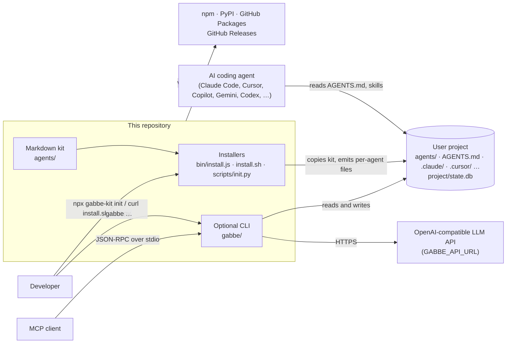
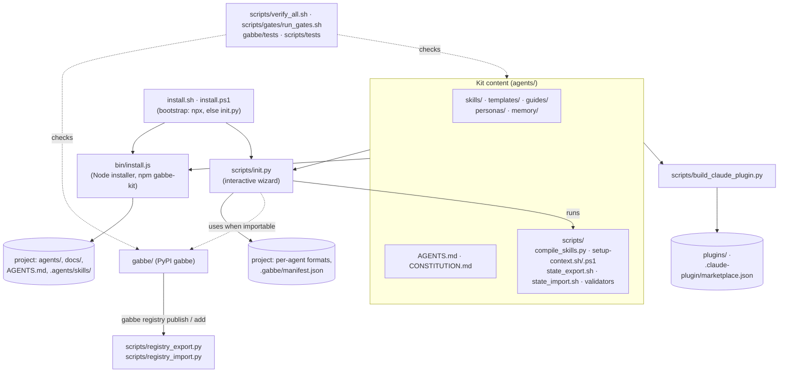
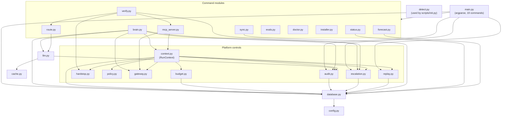

# GABBE architecture

> **Audience:** contributors and maintainers. **Scope:** the parts of this repository, what
> each one reads and writes, and how they connect. The reasons behind the larger decisions
> are in [`docs/adr/`](adr/); the emitted file formats are in [SCHEMA.md](SCHEMA.md).

GABBE has two layers. The **kit** (`agents/`) is Markdown that a coding agent reads; it works
with no code running. Installers copy the kit into a project and compile its skills into
each agent's native format. The optional **CLI** (`gabbe/`, Python) adds enforced budgets,
policy, audit, an MCP server and replay on top of a project's SQLite state.

## Context

## Parts of the repository

- `bin/install.js` copies `agents/` and `docs/`, writes a root `AGENTS.md`, emits the universal
  `.agents/skills/<slug>/SKILL.md` tree and wires the agents named with `--agents`. It writes no
  manifest ([INSTALL.md](INSTALL.md)).
- `scripts/init.py` asks questions, copies the kit, calls `agents/scripts/compile_skills.py` for
  each selected agent's format, and records what it created in `.gabbe/manifest.json` so
  `gabbe uninstall` can reverse it. It uses `gabbe/detect.py` for brownfield detection when the
  `gabbe` package is importable.
- `scripts/build_claude_plugin.py` turns every `agents/skills/**/*.skill.md` into the Claude Code
  plugins under `plugins/` (generated; never edit by hand).
- The emitter golden vault (`scripts/tests/golden/baseline_v0.8.0`) hashes every file the wizard
  writes, which includes every file under `agents/`. Any change there needs a recapture; see
  [TESTING.md](../TESTING.md).

## The CLI (`gabbe/`)

Each `gabbe` command runs in the project found by walking up from the current directory to the
first folder with `project/`, `.git` or `pyproject.toml` (`gabbe/config.py`). State lives in
that project's `project/state.db` (SQLite, schema v3), span logs in `project/logs/`, policy in
`project/policies.yml`. The arrows are the imports inside the package.

`config.py` (environment variables and paths) is imported by most modules; those arrows are
left out. `evals.py` runs `agents/scripts/eval_skills.py`; `doctor.py`, `installer.py` and
`detect.py` import nothing else from the package. What each control does, with its Python
API, is in [PLATFORM_CONTROLS.md](PLATFORM_CONTROLS.md); every command and variable is in
[CLI_REFERENCE.md](CLI_REFERENCE.md).
